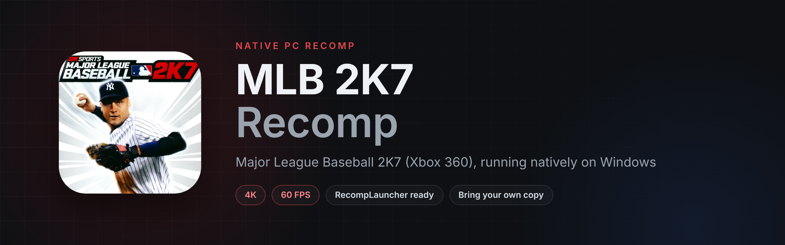

# MLB 2K7 Recomp

**Major League Baseball 2K7 (Xbox 360) running natively on Windows**, recompiled from the Xbox 360 game with ReXGlue. 1440p at a locked 60 FPS, up to 4K, set up from your own copy in a couple of clicks.

## Get it on RecompLauncher
The easiest way to play is **[RecompLauncher](https://recomplauncher.com)**. It installs the recomp, finds your copy, sets it up and keeps it updated, with every setting on the game's page.

## What's in it
- The Xbox 360 game recompiled to native PC code, not emulated
- 720p, 1440p or 4K, with 60 FPS held at 1440p on most graphics cards
- Colors and brightness corrected for PC monitors
- Sharpening, FSR upscaling for 4K screens, anti-aliasing and 16x texture filtering
- The licensed menu soundtrack
- A setup screen on first launch: drop in your disc image or game folder and it's ready
- Escape switches between fullscreen and a window
- Works with Xbox, PlayStation and most other controllers
- Full RecompLauncher support: Easy Setup, settings in the launcher and save backups

## What you need
- Windows 10 or 11 (64-bit) and a DirectX 12 graphics card
- Your **own** copy of Major League Baseball 2K7 for **Xbox 360** (USA). No game files are included.

## Which copies work
| | What to pick |
|---|---|
| Disc image | The `.iso` of your disc. It's unpacked once into the `game` folder (about 7 GB). |
| Game folder | A folder with `default.xex` and the game's files, from an extracted disc. It's used where it is. |

> [!TIP]
> ### 💙 Enjoying the recomp?
> If you've gotten some enjoyment out of this project, donations and love are always appreciated. Every bit helps keep these projects growing. Thank you!
>
> 

## Install by hand
1. Download `MLB2K7Recomp-v1.0.0-Windows-x64.zip` from [Releases](../../releases) and unzip it anywhere.
2. Run `MLB2K7Recomp.exe`.
3. On the setup screen, drop in your disc image or game folder, or use Choose file / Choose folder. The game starts once it's ready.

To update, unzip the new version over the old one. Your game files, saves and settings stay.

## Controls
| Key | Does |
|---|---|
| Controller | Same as the Xbox 360 version |
| Escape | Fullscreen or windowed |
| F3 | Performance overlay |

## Settings
Change them on the game's page in RecompLauncher, or in `MLB2K7Recomp.toml` next to the exe:

| Setting | Values |
|---|---|
| `resolution_scale` | `1` 720p, `2` 1440p, `3` 4K |
| `present_effect` | `"cas"` sharpen, `"fsr"` upscale for 4K screens, `"bilinear"` plain |
| `swap_post_effect` | `"none"`, `"fxaa"`, `"fxaa_extreme"` |
| `anisotropic_override` | `-1` game's own, `2` to `5` (5 is 16x) |
| `display_gamma` | `"srgb"` PC monitor, `"tv"` how it looked on an old TV |
| `music_volume` | `0` to `100` |
| `fullscreen`, `vsync`, `show_fps` | `true` or `false` |

Saves are in `Documents\MLB2K7Recomp`.

## Reporting a problem
Report bugs on the **[RIPALDA Discord](https://discord.gg/GgDE5Vynyu)**. Send the newest file from the `logs` folder next to the exe, with what you were doing and your settings.

## Building from source
The whole source is in this repository. See [BUILDING.md](BUILDING.md). You need your own copy of the game to build it, and nothing from the game is stored here.

## Credits
- **[elripalda](https://github.com/elripalda)**: the recomp, the graphics fixes, the setup screen, the RecompLauncher support and the art
- **[ReXGlue](https://github.com/rexglue/rexglue-sdk)**: the static recompiler and runtime, which builds on [Xenia](https://github.com/xenia-project/xenia) and [XenonRecomp](https://github.com/hedge-dev/XenonRecomp)
- [SDL3](https://github.com/libsdl-org/SDL), [Dear ImGui](https://github.com/ocornut/imgui) and AMD FidelityFX CAS and FSR
- Major League Baseball 2K7 was developed by Kush Games and published by 2K Sports

## License
This recomp's own code is under the [GPL-3.0](LICENSE). ReXGlue keeps its own BSD-style license. Neither covers the game, its artwork or its music.

*An unofficial fan project, not affiliated with or endorsed by 2K, Take-Two Interactive, Major League Baseball or Microsoft. No game files are included.*
